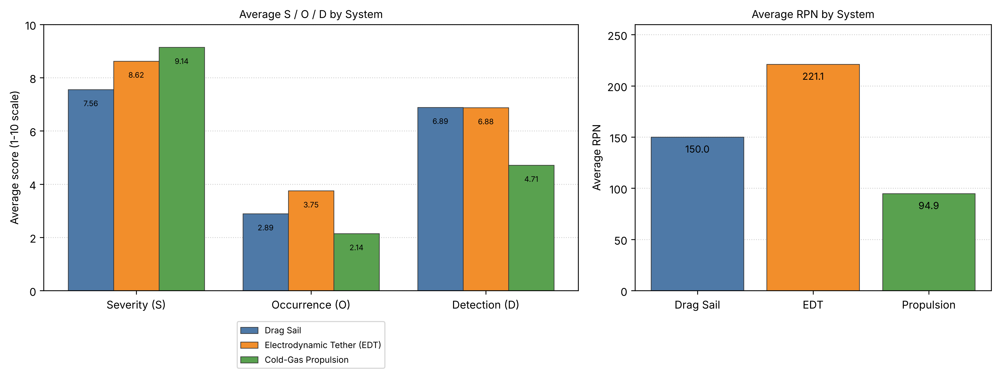

# FMEA for CubeSat Deorbit Systems — Reproducible Analysis

**Author:** Aisha Shermatova  
**Related peer-reviewed article:** Shermatova, A. (2026), *Failure Mode and Effects Analysis (FMEA) for CubeSat Deorbit Systems: A Comparative Risk Assessment of Drag Sails, Electrodynamic Tethers, and Propulsion Modules*, *Journal of Small Satellites*, 15(2), 1319–1331. Published October 30, 2026.  
**Official article:** https://jossonline.com/storage/2026/10/Final-Shermatova-Failure-Mode-and-Effects-Analysis-FMEA-for-CubeSat-Deorbit-Systems-1.pdf

## What this repository reproduces

This repository recomputes the **deterministic FMEA arithmetic and visualizations** from Tables 3–6 and Figures 1–4 of the published article. The input is a 24-row set of expert-assigned **Severity (S), Occurrence (O), Detection (D)** scores for drag sails, electrodynamic tethers and cold-gas propulsion modules; the risk priority number is defined as `RPN = S × O × D`.

The program recreates:

- The 9 drag-sail, 8 electrodynamic-tether and 7 propulsion failure-mode records, including RPN and action flags.
- Table 6 aggregate risk metrics and the RPN threshold counts.
- Figure 3 severity/occurrence matrix with bubble sizes for detection scores.
- Figure 4 Pareto ranking and cumulative percentage of summed RPN scores.
- Figure 1 functional decomposition and Figure 2 system comparison.

**Scientific scope:** This is an FMEA risk-ranking analysis, **not** an orbital dynamics simulation, flight reliability experiment, probability-of-failure estimate, or statistical confidence bound. An RPN is an ordinal priority heuristic, not a physical probability; summing RPNs produces a prioritization summary, not a measurement of expected mission loss. The published paper discusses that occurrence/detection scores rely in part on literature-informed engineering judgment.

## Reproduced numerical results

| Measure | Drag Sail | EDT | Cold-Gas Propulsion |
|---|---:|---:|---:|
| Failure modes | 9 | 8 | 7 |
| Mean S | 7.56 | 8.62 | 9.14 |
| Mean O | 2.89 | 3.75 | 2.14 |
| Mean D | 6.89 | 6.88 | 4.71 |
| Mean RPN | 150.0 | 221.1 | 94.9 |
| RPN ≥ 100 | 5 | 8 | 3 |
| RPN ≥ 150 | 4 | 6 | 1 |
| S = 10 | 2 | 2 | 4 |

The ten highest-ranked failure modes have combined RPN **2,424** out of **3,783** across all 24 records (**64.1%**); 50% is crossed at rank 8 and 80% at rank 15. The published numbers are rounded to the displayed precision.



## How to run

```bash
python -m pip install -r requirements.txt
python run_all.py
python -m unittest discover -s tests -v
```

`run_all.py` recomputes the numeric summaries, exports `fmea_tables.csv`, and overwrites the four figure PNGs in `figures/`. Different Matplotlib versions or fonts can change figure layout by a few pixels without changing the underlying values. Keep a backup if you want to preserve the exact uploaded PNGs.

**Files:** `data.py` stores the scores and descriptive labels; `metrics.py` computes the aggregates and Pareto rankings; `figures.py` creates Figures 1–4; `run_all.py` coordinates exports; `tests/` checks each published score tuple against a separately encoded copy of Tables 3–5 and verifies aggregates, CSV flags and figure rendering; `reports/` contains audit CSVs.

## Provenance and limitations

- The test suite verifies **numerical consistency with the published article** and internal calculation logic. It cannot validate original failure-rate evidence, mission-specific severity assumptions or score calibration.
- The uploaded ZIP was supplied after the paper's publication; this code release should not be described as definitive evidence of which exact scripts were executed during original manuscript preparation unless independent historical records establish that.
- The risk matrix highlights **S ≥ 8 and O ≥ 3.5**, while an **RPN ≥ 100** action threshold and separate **S ≥ 9** review gate come from the published scoring conventions.
- The publisher-produced article PDF is intentionally **not** redistributed in this repository. Use the official journal link above. Public redistribution of article materials and figures may depend on publishing agreements; confirm the rights you retained before making a public release.
- No software license has been selected in this private review package. Choose one deliberately before a public open-source release.

See `AUDIT_REPORT.md` for the detailed review and the distinction between computational reproducibility and independent engineering validity.
